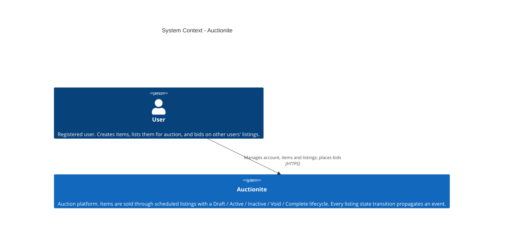
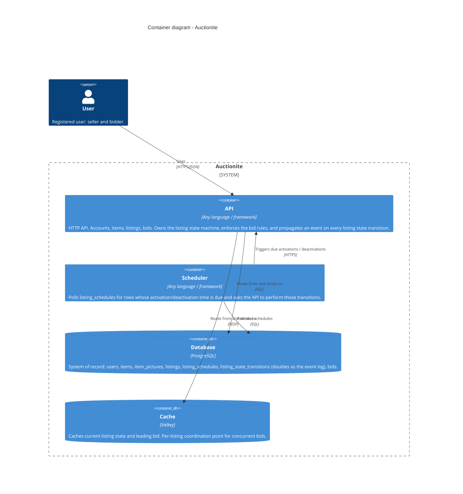
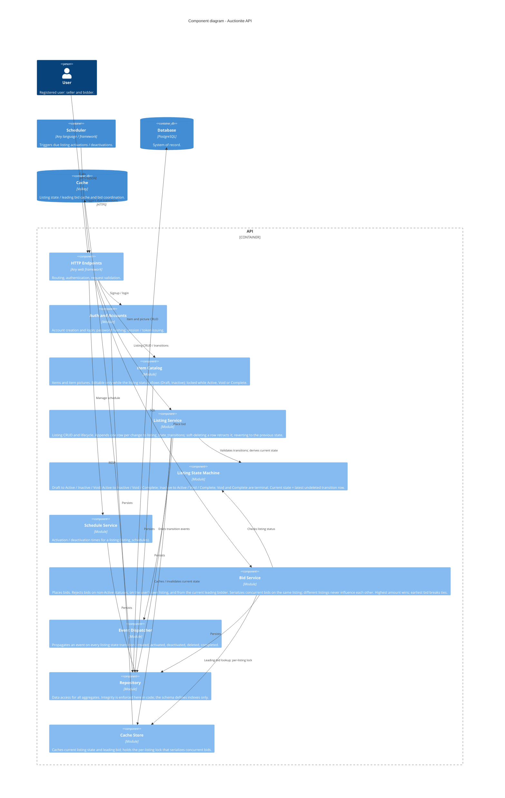

# Auctionite - Architecture

C4 model of the Auctionite auction platform, drawn with Mermaid.

Technology commitments:

- **Database:** PostgreSQL - system of record (schema per [erd.md](erd.md)).
- **Cache:** Valkey - hot reads (current listing state, leading bid) and per-listing bid coordination.
- **API / Scheduler:** language- and framework-agnostic - any stack that can serve HTTP and talk to PostgreSQL and Valkey.

## System Context (C4 Level 1)

One system, one actor: a registered user both sells and bids. Scheduling and event propagation are internal concerns, shown at the lower levels.

## Containers (C4 Level 2)

Design notes:

- **All state transitions go through the API.** The Scheduler never writes transitions itself; it only detects due schedules and calls the API, so the state machine and event dispatch live in exactly one place.
- **The transition rows are the events.** Per the ERD, `listing_state_transitions` doubles as the domain event log - no separate event store or broker is committed to.

## Components (C4 Level 3 - inside the API)

### How the spec maps to the components

- **Bid concurrency** ("two users bidding on the same listing at the same time"): the Bid Service takes a per-listing lock in Valkey, then writes the bid; contention on different listings never interacts.
- **Bid rules** (status, own-listing, already-leading): enforced by the Bid Service against the State Machine and the leading bid (`idx_bids_listing_leading` - highest amount, earliest bid breaks ties).
- **Scheduled activation/deactivation**: the Scheduler polls `listing_schedules` (indexed on `activates_at` / `deactivates_at`) and calls the API, which runs the normal transition path - state machine validation plus event dispatch.
- **Events**: every transition the Listing Service appends is pushed to the Event Dispatcher; the transition table itself is the durable event log.
